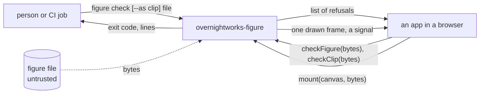
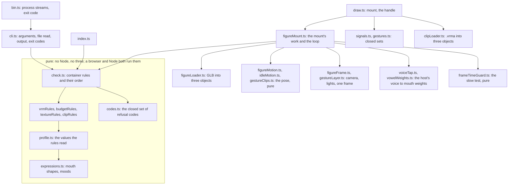
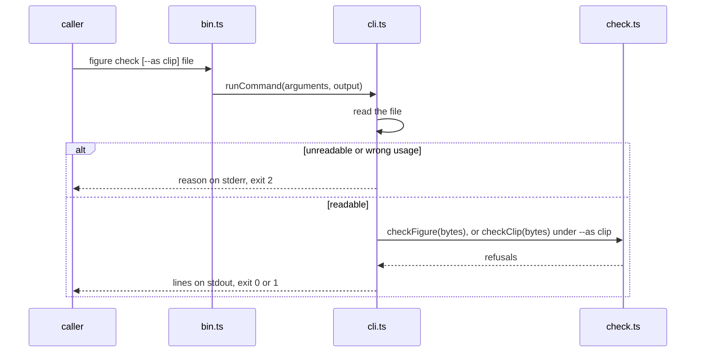

# figure architecture

## 1. Context and Scope

figure is a framework-free TypeScript ESM package. It holds the check, the profile's rules for a VRM 1.0 figure: a pure function from a figure file's bytes to a list of refusals, its sibling for a persona's gesture clip (a `.vrma` file), and the command `figure check [--as clip] <file>` around both; and the drawing export `overnightworks-figure/draw`, whose `mount` draws a figure into an app's canvas and keeps it alive: the figure breathes, blinks and glances until the app disposes it, and waves when the app asks, with a persona's clip in place of figure's wave when the app hands one. Three callers use it: a person or a CI job (personas' release check) runs the command in Node, an app calls `checkFigure` (or `checkClip`) in a browser before three parses the file, and an app calls `mount` on a canvas.



*Who calls the package and what crosses its edge; derived from `package.json` (`bin`, `exports`) and `src/`.*

## 2. Building Block View



*Module groups and their imports; derived from `src/`.*

- `codes.ts` owns every refusal code and its description. `signals.ts` (five signals: `drawn`, `unsupported`, `refused`, `lost`, `slow`, of which every one but `drawn` ends a figure), `gestures.ts` (`wave`) and `expressions.ts` (mouth shapes, moods) own the other closed sets; each is the one place a member is written.
- `profile.ts` owns the values the rules read: `figureProfile` and `clipProfile` (allowed extensions, file budget, version, required bones, and the mesh, texture and seconds budgets).
- `check.ts` owns the container rules and their order once for both profiles; `checkFigure` and `checkClip` differ in the profile and in the rules after the container. The rule modules judge parsed JSON and import only pure modules beside them (the codes, the profile, `json.ts`, and `clipRules.ts` also `clipKeyRules.ts`), no Node, three or @pixiv module; `textureRules.ts` also reads the binary chunk through `imageSize.ts`. `clipRules.ts` and `clipKeyRules.ts` judge a clip, and are narrower than `VRMC_vrm_animation` where a gesture needs it.
- `cli.ts` is the one filesystem boundary and the one output owner; `bin.ts` hands it the process streams.
- `index.ts` exports `checkFigure`, `checkClip`, the codes, both profiles and `figureGesture`; `overnightworks-figure/codes` and `/profile` export a subset. No module they reach imports three or three-vrm.
- `draw.ts` is the one module of `overnightworks-figure/draw`: it exports `mount`, `figureSignal` and the types of the handle, the options, the signal, the mood and the gesture. The handle is the last signal, an idempotent `dispose`, `think`, `listen`, `speak` and `gesture`. The types live in `mountOptions.ts`, so no declaration of the export names a three type (`scripts/check_packed_tarball.sh` follows them). `mount` is `figureMount.ts`' `mountWithClipLoad` given `clipLoader.ts`' `loadClip`; tests give it another parse.
- `figureMount.ts` owns the loop: one animation frame request at a time, the one place that draws. It runs only while the page is visible and the canvas is in the viewport, reads `prefers-reduced-motion` each frame, feeds each frame's interval to the guard and ends the figure with `slow` when it says so, and ends it with `lost` on `webglcontextlost`. No context is restored.
- Under reduced motion no gesture starts and a running one ends, and the chin share it had taken from the base arm returns to the chin at the thinking look's rate, the forearm folding ahead of the upper arm, also when the page lifts reduced motion on the way; `gesture` is also dropped for a value outside the set, while the page is hidden and on a figure that ended. A gesture is a moment, not a state.
- `figureMotion.ts` owns the order of the states (speaking over thinking over listening over idle) and the blending between them: a pure function of the facts the host reported through `think`, `listen` and `speak`, the elapsed seconds and a source of chance. The host reports a fact and the package decides the motion. `idleMotion.ts` is its idle layer; `gestureClips.ts` owns the clips' keys, the bones a clip plays and their lags.
- `figureFrame.ts` owns the picture: camera, lights, clear colour, the drawing buffer's size and the order in which the layers write the bones: base pose, gesture, deltas, head and neck, face. `gestureLayer.ts` holds the clip per gesture name, figure's own until a persona's replaces it.
- `clipLoader.ts` parses a `.vrma` that `checkClip` passed. The check is the only gate: `figureMount.ts` never hands a loader a byte the check refused. A `gestures` option clip is checked and parsed after `drawn`, without `mount` waiting; a refused clip, a failed load and a parse that ends after `dispose` are dropped with no signal.
- `voiceTap.ts` is the package's only touch of a host's audio graph: one analyser per voice, on the voice's own context, disconnected on the next voice, `dispose` and the figure's end. It creates no context and plays nothing. Only `figureMount.ts` imports it.


## 3. Runtime View



*The command's one flow; derived from `src/cli.ts`.*

```mermaid
sequenceDiagram
    participant A as app
    participant M as figureMount.ts
    participant K as check.ts
    participant L as figureLoader.ts
    participant P as clipLoader.ts
    participant I as figureMotion.ts
    participant F as figureFrame.ts
    A->>M: mount(canvas, bytes, onSignal)
    M->>K: checkFigure(bytes)
    alt refusals
        M-->>A: onSignal(refused), handle
    else none
        M->>M: canvas.getContext webgl2
        alt no context
            M-->>A: onSignal(unsupported), handle
        else context already lost
            M-->>A: onSignal(lost), handle
        else context
            M->>L: loadFigure(bytes)
            L-->>M: VRM, or an error
            alt the context was lost while the figure loaded
                M-->>A: onSignal(lost), handle
            else
                M->>F: first frame
                M-->>A: onSignal(drawn), handle
                opt options.gestures holds a clip under a gesture's name
                    M->>K: checkClip(clip bytes)
                    opt no refusal
                        M->>P: loadClip(clip bytes), without waiting
                        P-->>M: rotation tracks, or an error that drops the clip
                        M->>F: the gesture's clip replaces figure's own, unless disposed
                    end
                end
                loop each animation frame while the page is visible and the canvas is in the viewport, until dispose
                    M->>I: advance(facts, elapsed, reduced motion)
                    I-->>M: pose
                    M->>F: draw(pose)
                end
                opt the context is lost while the figure lives
                    M-->>A: onSignal(lost); the loop ends, no restore
                end
                opt the frame-time guard finds the figure slow
                    M-->>A: onSignal(slow); the loop ends, no restore
                end
            end
        end
    end
```

*`mount`'s one flow; derived from `src/figureMount.ts`. An error anywhere in loading or drawing, or a texture that fails, gives `refused` and frees the renderer; `mount` never rejects.* After `drawn`, the figure is drawn each animation frame, at the canvas's size and the device pixel ratio of that frame, while the page is visible and the canvas is in the viewport, until `dispose`, a context loss or a `slow` ending; no signal is given for a frame or a pause. A figure that ended runs no loop.

The loader's texture loader reads each image through an ``, because three's default fetches a `blob:` URL and the script policy refuses that. Its file loader always fails, so a buffer outside the GLB gives `refused` and no request, whatever the check said. The canvas is the host's: the renderer never writes its `style` and adds no element to the page.

The check's rules run in a fixed order. A refusal that leaves the later rules unjudgeable ends the check; the others all report:

1. `too_large` (judged on the file's length alone, reported beside any later refusal);
2. `not_glb` ends the check; `glb_version` and `glb_length` report; `glb_chunk` and `glb_json` end the check;
3. `extension_not_allowed`, `uri_not_allowed` and `buffer_outside_glb`;
4. the VRM rules: `not_vrm` alone when the VRM 1.0 extension is absent, else the preset, humanoid bone, look-at and licence codes;
5. the budgets, which read plain glTF and so judge a file that is `not_vrm` too: triangles and morph targets, counted from accessor fields, never from geometry;
6. the texture budgets, judged from headers only (`imageSize.ts` sizes a PNG, JPEG or WebP by its first bytes, never by `mimeType`); the stated size is compared with the budgets and never used to allocate or read.

A clip runs steps 1 to 3 against `clipProfile`, then the clip rules, all reported: the extension, the required humanoid, content a clip may not hold, the scene, at least one animation, every channel of every animation (the loader parses each) and the seconds budget. Channels on other nodes pass and are never played, and so do tracks for bones a gesture does not own.

## 4. Deployment View

The build is `tsc` alone and emits ESM and declarations to `dist/`. `prepack` runs it, so `pnpm pack` yields a tarball whose `figure` command runs in Node and whose modules a bundler takes. The package is private: nothing goes to npm. The build resolves imports as a bundler does, because three-vrm's types need it; `tests/tsconfig.node.json` type-checks the modules `bin.ts` reaches under Node's own resolution, which demands each relative import's `.js`.

A release is made by dispatching `.github/workflows/release.yml` with a version: quality's gate judges the commit, the build packs `overnightworks-figure-<version>.tgz` and proves it with `scripts/check_packed_tarball.sh`, and quality's tag job publishes the tarball, alone, on an immutable release whose notes carry its URL, its `sha512-` integrity and the gzip size of a checking and of a mounting consumer bundle (`scripts/measure_bundle_size.mjs`). quality's `docs/release.md` owns the path.

`scripts/measure_budget_figure.mjs` is the measurement behind the profile's budgets, taken in headless Chromium at 390 CSS pixels; a budget changes only on such a measurement.

## 5. Crosscutting Concepts

**Trust.** A figure file is untrusted input; no code comes from it. The check is about conformance and about protecting phones; it is not an app's security boundary. `mount` runs the check before three sees a byte.

**Proof strategy.** Branch coverage is 100 % over the check's cases, the in-process command tests and the browser project (`src/*.browser.test.ts`, headless Chromium through vitest's Playwright provider) together, reported as one `lcov.info`; `bin.ts` is reached only as a process, so its lines count as uncovered and its branches stay 100 % because it has none. A second layer drives `dist/bin.js` as a process for each exit code, and CI installs the packed tarball into an empty directory and runs it. Synthetic bytes come from builders that share no code with the check (`tests/glbBuilder.ts` for figures, `tests/clipBuilder.ts` for clips); the builder's one conformant VRM is proven by the check, by the glTF 2.0 and VRM 1.0 schemas, by the Khronos glTF validator and by `mount` drawing it in the browser layer.

A browser layer (`tests/e2e`, Playwright) packs the tarball, installs it into a temporary consumer, bundles that with Vite and serves it in headless Chromium under the script policy `default-src 'none'; script-src 'self'; connect-src 'self'; img-src 'self' blob:; worker-src 'self'`. It proves that the check runs in a browser on raw bytes, that `mount` gives `drawn` with the texture's colour, and that loading code, files and textures breaks no part of the policy. The browser project drives `mount`'s other signals, the handle and the canvas contract.

## 6. Constraints and reasons

- The check reads raw bytes and imports only the pure modules beside it, no Node, three or @pixiv module: a browser runs it before three parses a file, and personas' CI runs it in Node.
- Every refusal is one value of one closed set: callers branch on codes, never on wording.
- Exit codes are quality's (0 yes, 1 no, 2 could not answer), so a failure to judge is never read as a verdict.
- The runtime dependencies are `three`, `@pixiv/three-vrm` and `@pixiv/three-vrm-animation`, which draw and load the figure and read a persona's clip; only the `draw` export imports them, so a consumer that only checks loads none of them. All are on patch ranges and update together with `@types/three`.
- A gesture is a key of `figureGesture` in `gestures.ts` and nowhere else, so a gesture name outside it is dropped at the handle and a name without a clip does not compile.
- The tree holds no third-party model bytes.

## 7. Not chosen

- A bundler or linter of its own: `tsc` suffices and quality's gate judges.

## 8. Risks and Technical Debt

- Of the humanoid only the required bones are judged, not optional bones, a bone used twice or the hierarchy; spring bones, constraints and materials are not judged.
- Extension objects a file uses without declaring them in `extensionsUsed` are not scanned.
- The package does not validate image data: a corrupt image that the browser decodes without an error is drawn as decoded.
- The command reads the whole file before the check judges its size.
