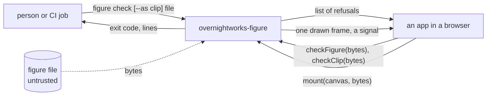
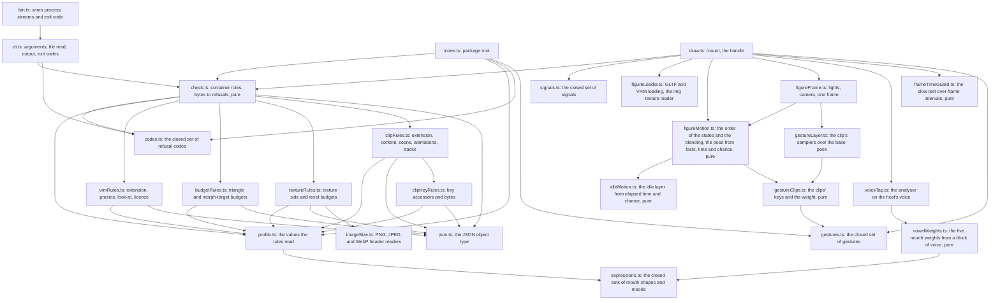
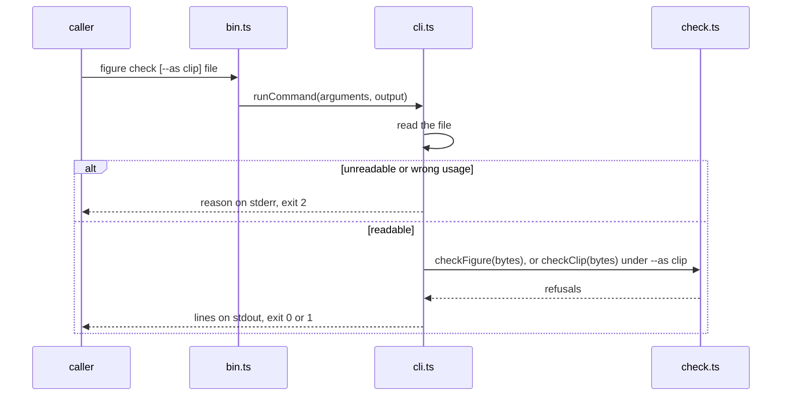

# figure architecture

## 1. Context and Scope

figure is a framework-free TypeScript ESM package. It holds the check, the profile's rules for a VRM 1.0 figure: a pure function from a figure file's bytes to a list of refusals, its sibling for a persona's gesture clip (a `.vrma` file), and the command `figure check [--as clip] <file>` around both; and the drawing export `overnightworks-figure/draw`, whose `mount` draws a figure into an app's canvas and keeps it alive: the figure breathes, blinks and glances until the app disposes it, and waves when the app asks. Three callers use it: a person or a CI job (personas' release check) runs the command in Node, an app calls `checkFigure` (or `checkClip`) in a browser before three parses the file, and an app calls `mount` on a canvas.



*Who calls the package and what crosses its edge; derived from `package.json` (`bin`, `exports`) and `src/`.*

## 2. Building Block View



*Module dependencies; derived from the imports in `src/`.*

- `codes.ts` owns every refusal code and its description.
- `profile.ts` owns the values the rules read: for a figure, `figureProfile` (allowed extensions, file budget, VRM version, presets, licence values and the mesh and texture budgets); for a clip, `clipProfile` (the one allowed extension `VRMC_vrm_animation`, its version, the file budget, the seconds budget and the rotation length tolerance); both name the same required bones. Its presets are composed from `expressions.ts`, which owns the closed sets of mouth shapes (`aa`, `ih`, `ou`, `ee`, `oh`) and moods and imports nothing, and the blink.
- `vowelWeights.ts` turns one block of time-domain samples into a weight from 0 to 1 for each mouth shape: the first two formants by linear prediction (autocorrelation, Levinson-Durbin and the roots of the predictor) on a frame low-passed (3 kHz) and resampled to 8 kHz with a kernel built once per sample rate, compared with a map of five vowels, scaled by the block's loudness; it reads the newest `analysisWindowLength` samples of the block. It is pure and imports neither three nor the DOM.
- `check.ts` owns the container rules and the order, once for both profiles (`checkFigure` and `checkClip` differ in the profile and in the rules after the container); it reads bytes. `vrmRules.ts` and `budgetRules.ts` judge the parsed JSON; none imports more than the codes, the profile and `json.ts`. `textureRules.ts` also reads the binary chunk through `imageSize.ts`. `clipRules.ts` judges a clip's extension, content, scene, animations and tracks, and `clipKeyRules.ts` the accessors and bytes of the keys of each channel; they import the codes, the profile and `json.ts` alone.
- `cli.ts` is the one filesystem boundary and the one output owner; `bin.ts` hands it the process streams.
- `index.ts` exports `checkFigure`, `checkClip`, the codes, both profiles and `figureGesture` with its type; `overnightworks-figure/codes` and `overnightworks-figure/profile` export those alone. No module they reach imports three or three-vrm.
- `gestures.ts` owns the closed set of gestures (`wave`) and the test for a member, and imports nothing; `draw.ts` re-exports its type, so the root and the handle's signature name no three type. `gestureClips.ts` is pure: per gesture one clip, per bone a list of keys (a time and a `Turn`, the angles the base pose writes) and a lag, and the clip's fades; a name without a clip does not compile. It owns the weight at a time, a smoothstep over each fade, exactly 0 at the start and the end and exactly 1 between, read at the bone's own clock, the gesture's seconds less its lag, so the lower arm and the hand trail the upper arm. `gestureLayer.ts` turns each bone's keys once, at the mount, into a linear quaternion track of three's `QuaternionLinearInterpolant`, and in each frame turns every bone of the clip from what the base wrote toward the sample by the weight. The keys are the clip: no animation container is read and nothing is fetched.
- `signals.ts` owns every signal (`drawn`, `unsupported`, `refused`, `lost`, `slow`); `unsupported`, `refused`, `lost` and `slow` end a figure. `frameTimeGuard.ts` owns the slow test, a pure function of the recent frame intervals that imports neither three nor the DOM; its two values are named once there.
- `draw.ts` is the one module of `overnightworks-figure/draw`: `mount` and the handle (the last signal, an idempotent `dispose`, `think`, `listen`, `speak` and `gesture`); its declarations name no three type. `figureLoader.ts` parses the bytes with three's GLTF loader and three-vrm's plugin and gives the parser an ``-based texture loader. `figureFrame.ts` owns the picture: the camera, lights and clear colour of hopin's agent-tile mockup, framed on the head and shoulders, and the drawing buffer's size, the canvas's client size times the device pixel ratio capped at 2. `figureMotion.ts` owns the order of the states and the blending between them, a pure function of the facts the host reported, the seconds since the last frame and a source of chance that imports neither three nor the DOM: today speaking wins over thinking, thinking over listening and listening over idle, and it gives the pose `figureFrame.ts` draws (the head's own turn, the lean the frame adds to the spine and the chest, the posture a state adds to it (the thinking look, and the listening nod every 2.5 to 5 seconds), which the frame spreads over the neck, head and chest the model has and which is zero at idle, the look-at, the blink weight, the five mouth weights (eased at 38 a second up and 22 down, with a nod of the head by their eased level), the five mood weights (eased at 9 a second up to their peaks while the sentence's mood is shown and at 4 down, with the mouth at 0.72 of itself while any shows, and a lean of head, trunk and shoulders by each mood's share) and the arms: the base pose is absolute, both arms lowered and, while the figure thinks, the right hand at the chin by the thinking look's weight, and the deltas (the shoulders' breath and lean, the trunk's breath, lean and mood, the chest's share of the posture) are added by `figureFrame.ts` to the rest the bones hold, in the order base pose, gesture, deltas, head and neck, face). The gesture is the pose's one field of the clip layer: its name and the seconds its clock has run, which `figureMotion.ts` owns as it owns every blend. The handle's `gesture` starts it at the next frame unless one runs or the page asks for reduced motion; `draw.ts` drops a value outside the set, a call while the page is hidden (a gesture is a moment, not a state), a call made under reduced motion and a call on a figure that ended. The frame writes the right hand at rest in the base, so no clip pose outlasts its clip; the clip has tracks for the right arm alone, so the breath, the lean and the moods, added after it to the trunk and the shoulders, go on under it, the head, the gaze, the blink, the mouth and the moods are written after it, and the thinking hand is the base under the clip: `figureMotion.ts` takes the base arm's chin share down by the share the clip's bones show at the most, so a wave lifts the hand from the chin along the bottom of the frame, not across the face, and gives it back along the same way. Under reduced motion no gesture starts and a running one ends at the next frame, the arm at its base pose at once. The gaze has one goal and two eases: the look-at reaches a new goal in a jump (nine tenths of it in about 60 ms) and the head follows at the picture's ease, so the eyes lead the head and both settle where the picture puts them (the head's shares, the look-at's gain and its clamp). The eyes also make small jumps of a few degrees, held until the next, as an offset on the look-at alone that the head never takes: at rest and while listening at their full size, at a share of it while the agent speaks, and never while it thinks. A shift of the gaze's goal beyond a threshold brings the next blink forward. Under reduced motion the look-at reaches the goal at once, there are no jumps and no blink is brought forward. `figureLoader.ts` also sets the five mood expressions to `overrideMouth` none, so a mood never silences the mouth. The facts reach it through `think` and `speak` on the handle, which the loop reads each frame; the host reports a fact and the package decides the motion. Where a speaker is reaches it as two numbers per frame, the offset of the element's centre from the canvas's as shares of half the viewport: `draw.ts` holds the element `listen` named only to read its rectangle and the canvas's, and counts an element that is no element, not connected, of another document or with no box (neither width nor height) as nobody. `voiceTap.ts` is the package's only touch of a host's audio graph: for a voice `speak` names it makes one analyser with the voice's own context, connects the voice to it, reads its time-domain samples into one buffer it keeps (sized to the smallest block that covers `vowelWeights`' window) in each drawn frame, and disconnects exactly that analyser on the next voice, `speak({})`, `speak(null)`, `dispose` and the figure's end; a voice it cannot tap gives no mouth and no error. It creates no context, connects nothing to a destination and plays nothing, and only `draw.ts` imports it, so no module reachable from `index.ts`, `codes.ts` or `profile.ts` does. `idleMotion.ts` is its base layer, the figure's idle life, also pure: breathing and swaying, a blink 2 to 6 seconds after the last one (brought forward to the moment of a far shift of the gaze, which the driver reports, but never to less than 2 seconds after the last one ended, and the gap after it drawn as after any blink), a glance 3 to 8 seconds after the last one began, with the values of the same mockup; the glance is one gaze source the driver picks from and splits between head and eyes, which it eases at two rates; the eyes' jumps are the other source of the look-at, drawn from the same source of chance. While the page asks for reduced motion the blink stays, slower, and the rest rests, the thinking and listening poses are reached and left at once, and no nod comes; the mouth and the moods reach their shapes at once and the voice's nod is off. `draw.ts` owns the loop: one animation frame request at a time, the one place that draws. It runs only while the page is visible (`visibilitychange`) and an `IntersectionObserver` reports the canvas in the viewport; a frame it has requested is cancelled when either stops, and a resumed loop counts no time for the pause. The loop gives the motion the frame's time and `Math.random` and reads the page's `prefers-reduced-motion` each frame, so a change of it is followed with no listener. A `webglcontextlost` listener on the canvas ends the loop and removes its own listeners, then gives `lost`; `dispose` removes them too, so its own loss gives no signal. The loop feeds each frame's interval to the guard and ends the figure with `slow` when the guard says so; a pause starts the guard's window anew. A context lost while the figure loads gives `lost` once the load ends, before any loop: no loop listens for it earlier, so the mount reads the context's state at that point. The drawing buffer follows the canvas in the loop's next frame, with no resize observer.

## 3. Runtime View



*The command's one flow; derived from `src/cli.ts`.*

```mermaid
sequenceDiagram
    participant A as app
    participant M as draw.ts
    participant K as check.ts
    participant L as figureLoader.ts
    participant I as figureMotion.ts
    participant F as figureFrame.ts
    A->>M: mount(canvas, bytes, onSignal)
    M->>K: checkFigure(bytes)
    alt refusals
        M-->>A: onSignal(refused), handle
    else none
        M->>M: canvas.getContext webgl2
        alt no context
            M-->>A: onSignal(unsupported), handle
        else context already lost
            M-->>A: onSignal(lost), handle
        else context
            M->>L: loadFigure(bytes)
            L-->>M: VRM, or an error
            alt the context was lost while the figure loaded
                M-->>A: onSignal(lost), handle
            else
                M->>F: first frame
                M-->>A: onSignal(drawn), handle
                loop each animation frame while the page is visible and the canvas is in the viewport, until dispose
                    M->>I: advance(facts, elapsed, reduced motion)
                    I-->>M: pose
                    M->>F: draw(pose)
                end
                opt the context is lost while the figure lives
                    M-->>A: onSignal(lost); the loop ends, no restore
                end
                opt the frame-time guard finds the figure slow
                    M-->>A: onSignal(slow); the loop ends, no restore
                end
            end
        end
    end
```

*`mount`'s one flow; derived from `src/draw.ts`. An error anywhere in loading or drawing, or a texture that fails, gives `refused` and frees the renderer; `mount` never rejects.* After `drawn`, the figure is drawn each animation frame, at the canvas's size and the device pixel ratio of that frame, while the page is visible and the canvas is in the viewport, until `dispose`, a context loss or a `slow` ending; no signal is given for a frame or a pause. A figure that ended runs no loop.

The loader's texture loader reads each image through an ``, because three's default fetches a `blob:` URL and the script policy refuses that; it also records a failed image, which three itself swallows. Its file loader always fails, so a buffer outside the GLB gives `refused` and no request, whatever the check said. The canvas is the host's: the renderer never writes its `style`, and the renderer adds no element to the page.

The check's rules run in a fixed order. A refusal that leaves the later rules unjudgeable ends the check; the others all report:

1. `too_large` (judged on the file's length alone, and reported beside any later refusal);
2. `not_glb` ends the check;
3. `glb_version` and `glb_length`, both reported;
4. `glb_chunk` (every chunk compared with the bytes that are there) ends the check;
5. `glb_json` ends the check;
6. `extension_not_allowed`, `uri_not_allowed` and `buffer_outside_glb`, all reported;
7. the VRM rules: `not_vrm` alone when the VRM 1.0 extension is absent, else `preset_missing` (one per preset), `humanoid_bone_missing` (one per required bone, `gltf_invalid` for a bone whose node names no entry of `nodes`), `look_at_missing` and the three `licence_*` codes;
8. the budgets, which read plain glTF and so judge a file that is `not_vrm` too: `too_many_triangles`, `too_many_morph_targets`, and `gltf_invalid` for a mesh, accessor or index they cannot read;
9. the texture budgets (`src/textureRules.ts`), which also read the binary chunk: `texture_too_large`, `too_many_texels`, `image_invalid`, and `gltf_invalid` for an image or buffer view they cannot read.

A clip runs steps 1 to 6 against `clipProfile` (the one extension it allows is `VRMC_vrm_animation`), then the clip rules in this order, all reported: `not_vrm_animation` when the extension object of version 1.0 is absent; `humanoid_bone_missing` (one per required bone) and `gltf_invalid` for a humanoid, expression or look-at node index that names no node; `clip_content_not_allowed` (one per property among `meshes`, `skins`, `materials`, `textures`, `images`, `samplers`, `cameras`); `clip_scene_missing` and `gltf_invalid` for a `scene` index that names no scene, a scene that is not an object or names a node that is no entry of `nodes`; `clip_animation_missing`; then every channel of every animation, because the loader parses each: `clip_track_not_allowed` for a channel without a target node, a `weights` channel, any path but rotation on a humanoid bone (or translation on the hips), any path but translation on an expression node, any path but rotation on the look-at node, and for key data that is sparse, has no buffer view or holds rotations that are not float; `gltf_invalid` for an accessor, buffer view, buffer, sampler or node that is missing or ill-shaped, a float accessor marked normalised, a stride on key data, a misaligned offset, or counts that do not fit the interpolation; `clip_keys_invalid` for keys past their buffer view or the binary chunk, times that are not finite, 0 or later and strictly ascending, and rotations that are not finite or not of unit length within the tolerance (a cubic spline's middle value of each key); `clip_too_long` when the first animation's last key is past the seconds budget. Channels on other nodes pass and are never played, and so do tracks for head, neck, eyes, jaw, expressions, look-at and hips translation, which the player drops. A clip is narrower than `VRMC_vrm_animation` where a gesture needs it: it requires the humanoid (the specification makes it optional), and its rotation keys are float and not sparse.

Triangles are counted from accessor fields, never from geometry: per primitive of each mesh once, the `count` of the `indices` accessor (else `POSITION`) divided by three for mode 4, less two for modes 5 and 6, none for modes 0 to 3. Only the presence of a preset or the look-at is judged.

Textures are judged from headers only. Each entry of `images` counts once, however many textures use it; an image with a `uri` is left to `uri_not_allowed`. Its bytes are the range its buffer view names in the binary chunk, compared with the chunk's length before any read. `imageSize` (`src/imageSize.ts`) sizes a PNG, a JPEG or a WebP by the image's first bytes, never by its `mimeType`, each in its own reader (`pngHeader.ts`, `jpegHeader.ts`, `webpHeader.ts`); any other image type is `image_invalid`. A JPEG's size is its first frame header, found by a forward walk over the segments; a WebP's is the first chunk's own header (lossy, lossless or the extended canvas). The stated size is compared with the budgets and never used to allocate or read.

## 4. Deployment View

The build is `tsc` alone and emits ESM and declarations to `dist/`. `prepack` runs it, so `pnpm pack` yields a tarball whose `figure` command runs in Node and whose modules a bundler takes. The package is private: nothing goes to npm. The build resolves imports as a bundler does, because three-vrm's types need it; `tests/tsconfig.node.json` type-checks the modules `bin.ts` reaches under Node's own resolution, which demands each relative import's `.js`.

A release is made by dispatching `.github/workflows/release.yml` with a version: quality's gate judges the commit, the build packs `overnightworks-figure-<version>.tgz` into `release-files` and proves it with `scripts/check_packed_tarball.sh`, and quality's tag job publishes the tarball on an immutable release. A release holds exactly that tarball; its notes carry the tarball's URL and `sha512-` integrity for a consumer that pins it by URL, then the gzip size of a consumer bundle that only checks and of one that also mounts, both computed from the packed tarball by `scripts/measure_bundle_size.mjs`. A failing size step fails the build before the tag. A consumer finds releases on the repository's releases page (`https://github.com/overnightworks/figure/releases`). quality's `docs/release.md` owns the path.

`scripts/measure_budget_figure.mjs` is the measurement behind the profile's budgets: it builds a synthetic figure at the budgets, checks it, mounts it in headless Chromium on a canvas 390 CSS pixels wide and reports the frame interval, whether `slow` came, the renderer and the GPU memory computed from what the figure uploads. A budget changes only on such a measurement.

## 5. Crosscutting Concepts

**Trust.** A figure file is untrusted input; no code comes from it. The check is about conformance and about protecting phones; it is not an app's security boundary. `mount` runs the check before three sees a byte.

**Proof strategy.** Branch coverage is 100 % over the check's cases, the in-process command tests and the browser project (`src/*.browser.test.ts`, headless Chromium through vitest's Playwright provider) together; one `vitest run --coverage` runs both projects and reports one `lcov.info`; the entry module `bin.ts` is reached only as a process, so its lines count as uncovered in that report (branches stay 100 % because it has none). A second layer drives `dist/bin.js` as a process for each exit code, and CI installs the packed tarball into an empty directory and runs it. Synthetic GLB bytes come from test builders that share no code with the check: one for figures, one for clips (`tests/clipBuilder.ts`). `scripts/write_base_clips.mjs` writes figure's base clips from the keys of the built gestures, and `scripts/check_packed_tarball.sh` passes each through `figure check --as clip` from the packed tarball.

The builder's one conformant VRM is a small figure: the required bones plus chest and neck on a hierarchy, a torso and a head box with vertex data skinned to spine, chest and head, a blink morph target bound by the `blink` preset, a core material with a base colour texture, and a PNG with image data and checksums. Every test, the script the workflows run and the tarball proof start from this file. Today it is proven by the check (no refusal), by tests that read its structure back from the glTF 2.0 and VRM 1.0 schemas, by the Khronos glTF validator (no error; it also decodes the PNG), and by the browser layer, where `mount` draws it and shows the texture's colour.

A browser layer (`tests/e2e`, Playwright) packs the tarball, installs it into a temporary consumer, bundles that with Vite and serves it in headless Chromium under the script policy `default-src 'none'; script-src 'self'; connect-src 'self'; img-src 'self' blob:; worker-src 'self'`, which every response of the page carries. It proves that the check runs in a browser on raw bytes, that `mount` gives `drawn` with the texture's colour on the canvas, and that loading code, files and textures breaks no part of the policy. Its coverage is not measured: the browser project covers the same code. A missing WebGL 2 makes it red. The browser project drives `mount`'s other signals, the handle and the canvas contract.

## 6. Constraints and reasons

- The check reads raw bytes and imports no module: a browser runs it before three parses a file, and personas' CI runs it in Node.
- Every refusal is one value of one closed set: callers branch on codes, never on wording.
- Exit codes are quality's (0 yes, 1 no, 2 could not answer), so a failure to judge is never read as a verdict.
- The runtime dependencies are `three` and `@pixiv/three-vrm`, which draw and load the figure; only the `draw` export imports them, so a consumer that only checks loads neither. Both are on patch ranges and update together with `@types/three`.
- A gesture is a key of `figureGesture` in `gestures.ts` and nowhere else, so a gesture name outside it is dropped at the handle and a name without a clip does not compile.
- The tree holds no third-party model bytes.

## 7. Not chosen

- A bundler or linter of its own: `tsc` suffices and quality's gate judges.

## 8. Risks and Technical Debt

- Of the humanoid only the required bones are judged, not optional bones, a bone used twice or the hierarchy; spring bones, constraints and materials are not judged.
- Extension objects a file uses without declaring them in `extensionsUsed` are not scanned.
- The package does not validate image data: a corrupt image that the browser decodes without an error is drawn as decoded.
- The command reads the whole file before the check judges its size.
