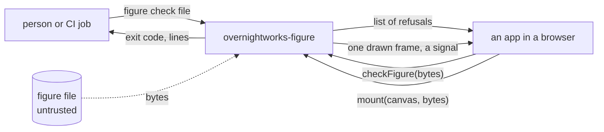
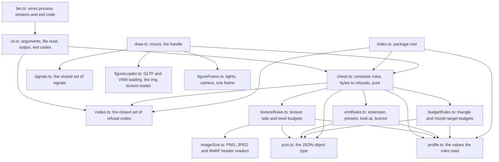
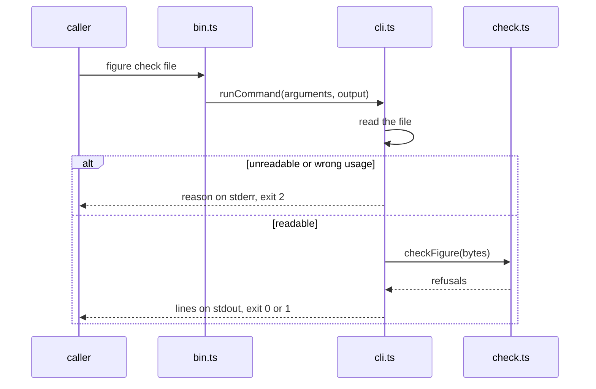
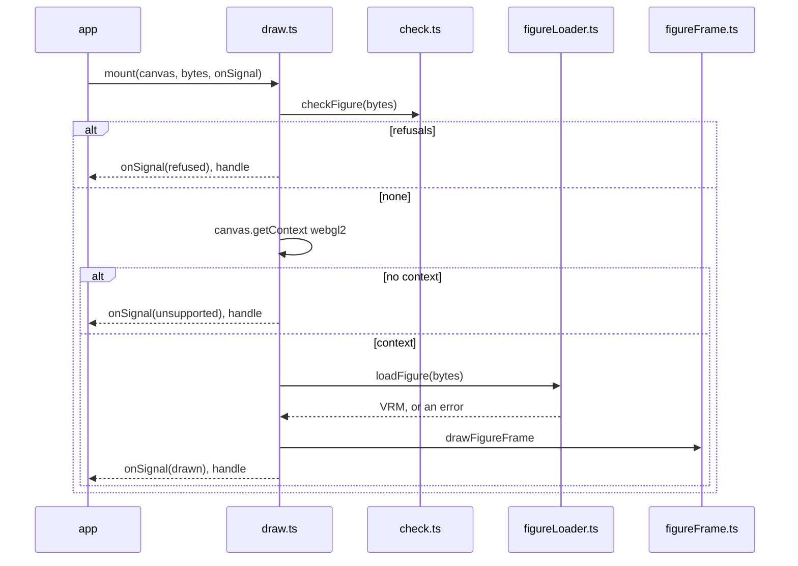

# figure architecture

## 1. Context and Scope

figure is a framework-free TypeScript ESM package. It holds the check, the profile's rules for a VRM 1.0 figure: a pure function from a figure file's
bytes to a list of refusals, and the command `figure check <file>` around it; and the drawing export `overnightworks-figure/draw`, whose `mount` draws one frame of a figure into
an app's canvas. Three callers use it: a person or a CI job (personas' release check) runs the command in Node, an app calls `checkFigure` in a browser before three parses
the file, and an app calls `mount` on a canvas.

*Who calls the package and what crosses its edge; derived from `package.json` (`bin`, `exports`) and `src/`.*

## 2. Building Block View

*Module dependencies; derived from the imports in `src/`.*

- `codes.ts` owns every refusal code and its description.
- `profile.ts` owns the values the rules read: allowed extensions, file budget, VRM version, presets, licence values and the two mesh budgets.
- `check.ts` owns the container rules and the order; it reads bytes. `vrmRules.ts` and `budgetRules.ts` judge the parsed JSON; none imports more than the codes, the profile and `json.ts`. `textureRules.ts` also reads the binary chunk through `imageSize.ts`.
- `cli.ts` is the one filesystem boundary and the one output owner; `bin.ts` hands it the process streams.
- `index.ts` exports `checkFigure`, the codes and the profile; `overnightworks-figure/codes` and `overnightworks-figure/profile` export those alone. No module they reach imports three or three-vrm.
- `signals.ts` owns every signal (`drawn`, `unsupported`, `refused`, `lost`, `slow`); `lost` and `slow` have no producer yet.
- `draw.ts` is the one module of `overnightworks-figure/draw`: `mount` and the handle (the last signal and an idempotent `dispose`); its declarations name no three type. `figureLoader.ts` parses the bytes with three's GLTF loader and three-vrm's plugin and gives the parser an ``-based texture loader. `figureFrame.ts` owns the picture: the camera, lights and clear colour of hopin's agent-tile mockup, framed on the head and shoulders.

## 3. Runtime View

*The command's one flow; derived from `src/cli.ts`.*

*`mount`'s one flow; derived from `src/draw.ts`. An error anywhere in loading or drawing, or a texture that fails, gives `refused` and frees the renderer; `mount` never rejects.*

The loader's texture loader reads each image through an ``, because three's default fetches a `blob:` URL and the script policy refuses that; it also records a failed image, which three itself swallows. The canvas is the host's: the renderer never writes its `style`, and no element is created.

The check's rules run in a fixed order. A refusal that leaves the later rules unjudgeable ends the check; the others all
report:

1. `too_large` (judged on the file's length alone, and reported beside any later refusal);
2. `not_glb` ends the check;
3. `glb_version` and `glb_length`, both reported;
4. `glb_chunk` (every chunk compared with the bytes that are there) ends the check;
5. `glb_json` ends the check;
6. `extension_not_allowed` and `uri_not_allowed`, both reported;
7. the VRM rules: `not_vrm` alone when the VRM 1.0 extension is absent, else `preset_missing` (one per preset),
   `humanoid_bone_missing` (one per required bone, `gltf_invalid` for a bone whose node names no entry of `nodes`), `look_at_missing` and the three `licence_*` codes;
8. the budgets, which read plain glTF and so judge a file that is `not_vrm` too: `too_many_triangles`,
   `too_many_morph_targets`, and `gltf_invalid` for a mesh, accessor or index they cannot read;
9. the texture budgets (`src/textureRules.ts`), which also read the binary chunk: `texture_too_large`,
   `too_many_texels`, `image_invalid`, and `gltf_invalid` for an image or buffer view they cannot read.

Triangles are counted from accessor fields, never from geometry: per primitive of each mesh once, the `count` of the
`indices` accessor (else `POSITION`) divided by three for mode 4, less two for modes 5 and 6, none for modes 0 to 3.
Only the presence of a preset or the look-at is judged.

Textures are judged from headers only. Each entry of `images` counts once, however many textures use it; an image with
a `uri` is left to `uri_not_allowed`. Its bytes are the range its buffer view names in the binary chunk, compared with
the chunk's length before any read. `imageSize` (`src/imageSize.ts`) sizes a PNG, a JPEG or a WebP by the image's first
bytes, never by its `mimeType`, each in its own reader (`pngHeader.ts`, `jpegHeader.ts`, `webpHeader.ts`); any other
image type is `image_invalid`. A JPEG's size is its first frame header, found by a forward walk over the segments; a
WebP's is the first chunk's own header (lossy, lossless or the extended canvas). The stated size is compared with the
budgets and never used to allocate or read.

## 4. Deployment View

The build is `tsc` alone and emits ESM and declarations to `dist/`. `prepack` runs it, so `pnpm pack` yields a tarball
whose `figure` command runs in Node and whose modules a bundler takes. The package is private: nothing goes to npm.

A release is made by dispatching `.github/workflows/release.yml` with a version: quality's gate judges the commit, the
build packs `overnightworks-figure-<version>.tgz` into `release-files` and proves it with
`scripts/check_packed_tarball.sh`, and quality's tag job publishes the tarball on an immutable release, whose notes carry
the tarball's `sha512-` integrity for a consumer that pins it by URL. Releases exist; a consumer finds them on the
repository's releases page (`https://github.com/overnightworks/figure/releases`). quality's `docs/release.md` owns the path.

## 5. Crosscutting Concepts

**Trust.** A figure file is untrusted input; no code comes from it. The check is about conformance and about
protecting phones; it is not an app's security boundary. `mount` runs the check before three sees a byte.

**Proof strategy.** Branch coverage is 100 % over the check's cases, the in-process command tests and the browser project (`src/*.browser.test.ts`, headless Chromium through vitest's Playwright provider) together; one `vitest run --coverage` runs both projects and reports one `lcov.info`; the entry module `bin.ts` is reached only as a process, so its lines count as uncovered in that report
(branches stay 100 % because it has none). A second layer drives `dist/bin.js` as a process for each exit code, and CI
installs the packed tarball into an empty directory and runs it. Synthetic GLB bytes come from a test builder that
shares no code with the check.

The builder's one conformant VRM is a small figure: the required bones plus chest and neck on a hierarchy, a torso and a
head box with vertex data skinned to spine, chest and head, a blink morph target bound by the `blink` preset, a core
material with a base colour texture, and a PNG with image data and checksums. Every test, the script the workflows run
and the tarball proof start from this file. Today it is proven by the check (no refusal), by tests that read its
structure back from the glTF 2.0 and VRM 1.0 schemas, by the Khronos glTF validator (no error; it also decodes the PNG),
and by the browser layer, where `mount` draws it and shows the texture's colour.

A browser layer (`tests/e2e`, Playwright) packs the tarball, installs it into a temporary consumer, bundles that with Vite
and serves it in headless Chromium under the script policy `default-src 'none'; script-src 'self'; connect-src 'self';
img-src 'self' blob:; worker-src 'self'`, which every response of the page carries. It proves that the check runs in a
browser on raw bytes, that `mount` gives `drawn` with the texture's colour on the canvas, and that loading code, files and
textures breaks no part of the policy. Its coverage is not measured: the browser project covers the same code. A missing
WebGL 2 makes it red. The browser project drives `mount`'s other signals, the handle and the canvas contract.

## 6. Constraints and reasons

- The check reads raw bytes and imports no module: a browser runs it before three parses a file, and personas' CI runs it in Node.
- Every refusal is one value of one closed set: callers branch on codes, never on wording.
- Exit codes are quality's (0 yes, 1 no, 2 could not answer), so a failure to judge is never read as a verdict.
- The runtime dependencies are `three` and `@pixiv/three-vrm`, which draw and load the figure; only the `draw` export imports them, so a consumer that only checks loads neither. Both are on patch ranges and update together with `@types/three`.
- The tree holds no third-party model bytes.

## 7. Not chosen

- A bundler or linter of its own: `tsc` suffices and quality's gate judges.

## 8. Risks and Technical Debt

- Of the humanoid only the required bones are judged, not optional bones, a bone used twice or the hierarchy; spring bones, constraints and materials are not judged.
- Extension objects a file uses without declaring them in `extensionsUsed` are not scanned.
- The command reads the whole file before the check judges its size.
