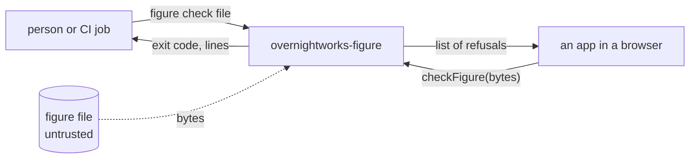
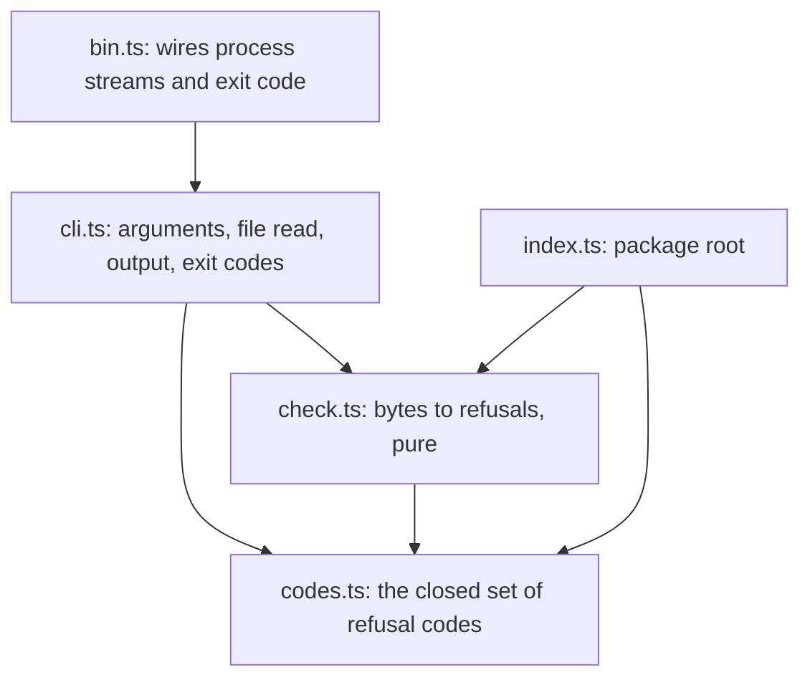
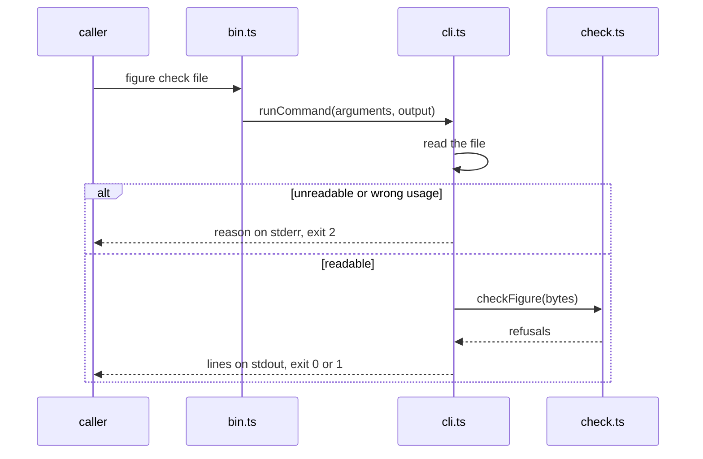

# figure architecture

## 1. Context and Scope

figure is a framework-free TypeScript ESM package. Today it holds the check: a pure function from a figure file's
bytes to a list of refusals, and the command `figure check <file>` around it. Two callers use it: a person or a CI job
(personas' release check) runs the command in Node, and an app calls `checkFigure` in a browser before three parses
the file.

*Who calls the package and what crosses its edge; derived from `package.json` (`bin`, `exports`) and `src/`.*

## 2. Building Block View

*Module dependencies; derived from the imports in `src/`.*

- `codes.ts` owns every refusal code and its description.
- `check.ts` owns the rules; it reads bytes and imports nothing.
- `cli.ts` is the one filesystem boundary and the one output owner; `bin.ts` hands it the process streams.
- `index.ts` exports `checkFigure` and the codes; `overnightworks-figure/codes` exports the codes alone.

## 3. Runtime View

*The command's one flow; derived from `src/cli.ts`.*

## 4. Deployment View

The build is `tsc` alone and emits ESM and declarations to `dist/`. `prepack` runs it, so `pnpm pack` yields a tarball
whose `figure` command runs in Node and whose modules a bundler takes. The package is private: nothing goes to npm.

## 5. Crosscutting Concepts

**Trust.** A figure file is untrusted input; no code comes from it. The check is about conformance and about
protecting phones; it is not an app's security boundary.

**Proof strategy.** Branch coverage is 100 % over the check's cases and the in-process command tests together, reported
as `lcov.info`; the entry module `bin.ts` is reached only as a process, so its lines count as uncovered in that report
(branches stay 100 % because it has none). A second layer drives `dist/bin.js` as a process for each exit code, and CI
installs the packed tarball into an empty directory and runs it. Synthetic GLB bytes come from a test builder that
shares no code with the check.

## 6. Constraints and reasons

- The check reads raw bytes and imports no module: a browser runs it before three parses a file, and personas' CI runs it in Node.
- Every refusal is one value of one closed set: callers branch on codes, never on wording.
- Exit codes are quality's (0 yes, 1 no, 2 could not answer), so a failure to judge is never read as a verdict.
- There is no runtime dependency; the tree holds no third-party model bytes.

## 7. Not chosen

- A bundler or linter of its own: `tsc` suffices and quality's gate judges.

## 8. Risks and Technical Debt

- Only one rule exists; a file with a GLB header can still be malformed.
