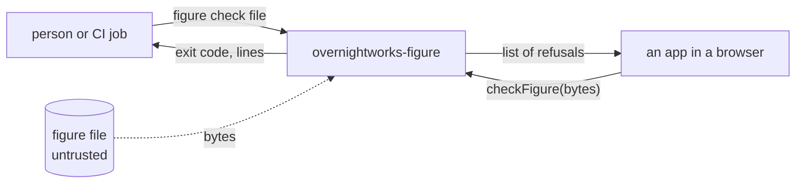
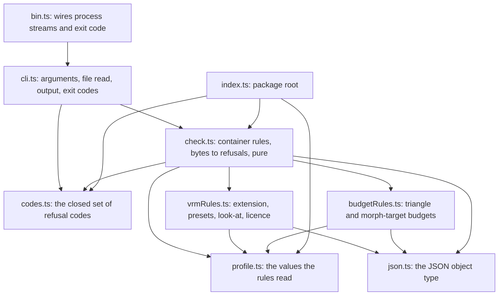
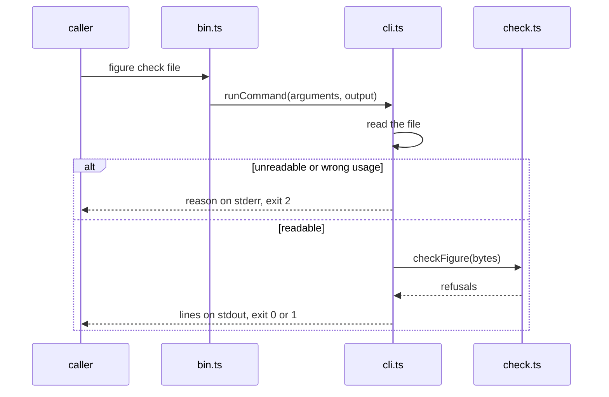

# figure architecture

## 1. Context and Scope

figure is a framework-free TypeScript ESM package. Today it holds the check, the profile's rules for a VRM 1.0 figure: a pure function from a figure file's
bytes to a list of refusals, and the command `figure check <file>` around it. Two callers use it: a person or a CI job
(personas' release check) runs the command in Node, and an app calls `checkFigure` in a browser before three parses
the file.

*Who calls the package and what crosses its edge; derived from `package.json` (`bin`, `exports`) and `src/`.*

## 2. Building Block View

*Module dependencies; derived from the imports in `src/`.*

- `codes.ts` owns every refusal code and its description.
- `profile.ts` owns the values the rules read: allowed extensions, file budget, VRM version, presets, licence values and the two mesh budgets.
- `check.ts` owns the container rules and the order; it reads bytes. `vrmRules.ts` and `budgetRules.ts` judge the parsed JSON; none imports more than the codes, the profile and `json.ts`.
- `cli.ts` is the one filesystem boundary and the one output owner; `bin.ts` hands it the process streams.
- `index.ts` exports `checkFigure`, the codes and the profile; `overnightworks-figure/codes` and `overnightworks-figure/profile` export those alone.

## 3. Runtime View

*The command's one flow; derived from `src/cli.ts`.*

The rules run in a fixed order. A refusal that leaves the later rules unjudgeable ends the check; the others all
report:

1. `too_large` (judged on the file's length alone, and reported beside any later refusal);
2. `not_glb` ends the check;
3. `glb_version` and `glb_length`, both reported;
4. `glb_chunk` (every chunk compared with the bytes that are there) ends the check;
5. `glb_json` ends the check;
6. `extension_not_allowed` and `uri_not_allowed`, both reported;
7. the VRM rules: `not_vrm` alone when the VRM 1.0 extension is absent, else `preset_missing` (one per preset),
   `look_at_missing` and the three `licence_*` codes;
8. the budgets, which read plain glTF and so judge a file that is `not_vrm` too: `too_many_triangles`,
   `too_many_morph_targets`, and `gltf_invalid` for a mesh, accessor or index they cannot read;
9. the texture budgets (`src/textureRules.ts`), which also read the binary chunk: `texture_too_large`,
   `too_many_texels`, `image_invalid`, and `gltf_invalid` for an image or buffer view they cannot read.

Triangles are counted from accessor fields, never from geometry: per primitive of each mesh once, the `count` of the
`indices` accessor (else `POSITION`) divided by three for mode 4, less two for modes 5 and 6, none for modes 0 to 3.
Only the presence of a preset or the look-at is judged.

Textures are judged from headers only. Each entry of `images` counts once, however many textures use it; an image with
a `uri` is left to `uri_not_allowed`. Its bytes are the range its buffer view names in the binary chunk, compared with
the chunk's length before any read. Today only a PNG is sized, from its signature and header chunk (`src/pngHeader.ts`);
any other image type is `image_invalid`. The stated size is compared with the budgets and never used to allocate or read.

## 4. Deployment View

The build is `tsc` alone and emits ESM and declarations to `dist/`. `prepack` runs it, so `pnpm pack` yields a tarball
whose `figure` command runs in Node and whose modules a bundler takes. The package is private: nothing goes to npm.

## 5. Crosscutting Concepts

**Trust.** A figure file is untrusted input; no code comes from it. The check is about conformance and about
protecting phones; it is not an app's security boundary.

**Proof strategy.** Branch coverage is 100 % over the check's cases and the in-process command tests together, reported
as `lcov.info`; the entry module `bin.ts` is reached only as a process, so its lines count as uncovered in that report
(branches stay 100 % because it has none). A second layer drives `dist/bin.js` as a process for each exit code, and CI
installs the packed tarball into an empty directory and runs it. Synthetic GLB bytes come from a test builder that
shares no code with the check.

## 6. Constraints and reasons

- The check reads raw bytes and imports no module: a browser runs it before three parses a file, and personas' CI runs it in Node.
- Every refusal is one value of one closed set: callers branch on codes, never on wording.
- Exit codes are quality's (0 yes, 1 no, 2 could not answer), so a failure to judge is never read as a verdict.
- There is no runtime dependency; the tree holds no third-party model bytes.

## 7. Not chosen

- A bundler or linter of its own: `tsc` suffices and quality's gate judges.

## 8. Risks and Technical Debt

- The texture budgets are not built; a file the rules pass can still hold oversized textures.
- The humanoid, spring bones, constraints and materials are not judged.
- Extension objects a file uses without declaring them in `extensionsUsed` are not scanned.
- The command reads the whole file before the check judges its size.
